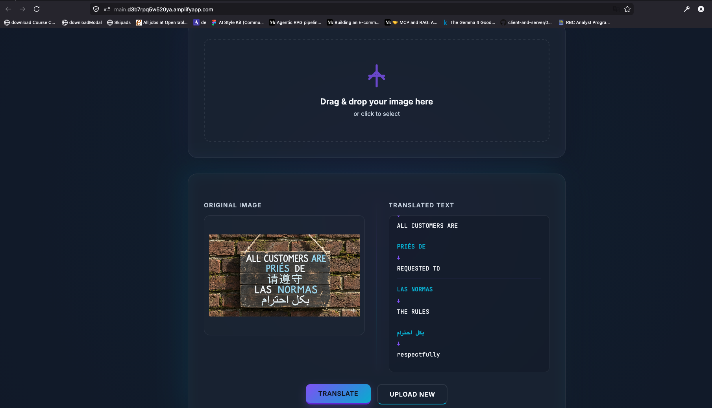

# Pictorial Translate

Upload a photo of a sign, menu, or label. Pictorial Translate finds the printed text, translates it into English, and reads it aloud.

**Live site:** https://main.dvsybtsoulkw3.amplifyapp.com
**Access:** invite-only. Sign-in is handled by Clerk.



## How it works

1. **Upload:** the image is saved to S3 under a generated key, so the user's file name never reaches S3 or the URL.
2. **Find text:** Amazon Rekognition detects text lines. Lines below 80% confidence are dropped.
3. **Translate:** Amazon Translate converts each line to English, with the source language detected automatically.
4. **Listen:** Amazon Polly reads the translation aloud with the standard English voice.

```
Browser (Clerk sign-in) ──> Amplify (static site) ──> API Gateway ──> Lambda (Chalice)
                                                                         │
                                                  S3 · Rekognition · Translate · Polly
```

## API

Every route requires a Clerk session token in the `Authorization: Bearer <token>` header. Requests without a valid token get `401`.

| Method | Route | Purpose |
|--------|-------|---------|
| `POST` | `/images` | Upload an image (`filename`, base64 `filebytes`). Returns `fileId` and a 1-hour signed `fileUrl`. |
| `POST` | `/images/{image_id}/translate-text` | Detect and translate the text in an uploaded image. |
| `POST` | `/speech` | Convert text to speech. Returns base64 MP3. Limited to 3,000 characters. |

Uploads accept JPG, JPEG, and PNG only, since those are the formats Rekognition reads.

## Project structure

```
.
├── Capabilities/                  # Backend (Chalice on AWS Lambda)
│   ├── app.py                     # Routes and the require_auth decorator
│   ├── chalicelib/
│   │   ├── auth_service.py        # Verifies Clerk tokens against the JWKS endpoint
│   │   ├── storage_service.py     # S3 upload and key generation
│   │   ├── recognition_service.py # Rekognition text detection
│   │   ├── translation_service.py # Translate
│   │   ├── polly_service.py       # Polly text-to-speech
│   │   └── aws_config.py          # Region setting
│   └── .chalice/                  # Stage config and IAM policy for the Lambda
├── website/                       # Frontend (static HTML, CSS, JavaScript)
│   ├── index.html                 # Landing page (signed out) and app (signed in)
│   ├── scripts.js                 # Clerk sign-in, upload, translate, listen
│   ├── styles.css                 # App styles
│   └── demo.mp4                   # Demo video for the landing page
├── testing/                       # Unit tests and service copies used by the tests
├── testimage/                     # Sample images
├── ARCHITECTURE.md
├── PRODUCTION_SETUP.md
├── Dockerfile
├── Makefile
└── .github/workflows/ci.yml
```

## Local development

### Prerequisites

- Python 3.11+
- AWS credentials with access to S3, Rekognition, Translate, and Polly
- Docker (optional, for the container build)

### Install and test

```bash
make install     # installs root, Capabilities, and test requirements
make test        # runs unit tests against live AWS services
```

The tests call Translate and Polly directly, so they need working AWS credentials.

### Run the backend

```bash
cd Capabilities
chalice local    # serves on http://localhost:8000
```

Requests without a token return `401`. To test the full flow, sign in with Clerk and send the token with each request.

### Run the frontend

```bash
cd website
python3 -m http.server 8080
```

Open http://localhost:8080. The page calls the API set in `serverUrl` in `scripts.js`, which is the deployed API by default. Change it to `http://localhost:8000` to test against `chalice local`.

## Deployment

### Backend

```bash
cd Capabilities
chalice deploy --stage dev
```

Chalice prints the API URL. Update `serverUrl` in `website/scripts.js` if it changes.

The Lambda's permissions come from `Capabilities/.chalice/policy-dev.json`. The S3 bucket name is set in `storage_location` in `Capabilities/app.py`. Bucket names are globally unique, so change this when you deploy to a new account.

### Frontend

The site is hosted on AWS Amplify. The live site is a manual upload of the `website/` files. To update it, upload the files again, or connect the repository to Amplify in the console for automatic builds.

## Authentication

Clerk handles sign-in. The backend checks each token's signature against Clerk's public keys (`CLERK_JWKS_URL` in `Capabilities/.chalice/config.json`). Access is limited by Clerk's sign-up settings: sign-ups are restricted and users need an invitation.

## Known limits

- No per-user rate limits. Anyone signed in can make as many calls as they like.
- No file size limit on uploads.
- Pre-signed image links are valid for one hour and work for anyone who has them.
- CORS allows all origins.
- `app.debug` is set to `True` in `app.py`.

## Make targets

- `make install`: install dependencies
- `make test`: run unit tests
- `make test-verbose`: run tests with verbose output
- `make test-coverage`: run tests with a coverage report
- `make lint`: run pylint
- `make format`: format code with black
- `make clean`: remove build artifacts
- `make docker-build`: build the Docker image
- `make docker-run`: run the API in Docker

## CI/CD

GitHub Actions runs on every push and pull request. It runs the tests, checks formatting and lint, runs security scans (bandit and safety), and builds the Docker image. See `.github/workflows/ci.yml`.

## License

MIT

## Author

Anmol Sagar Shrestha
